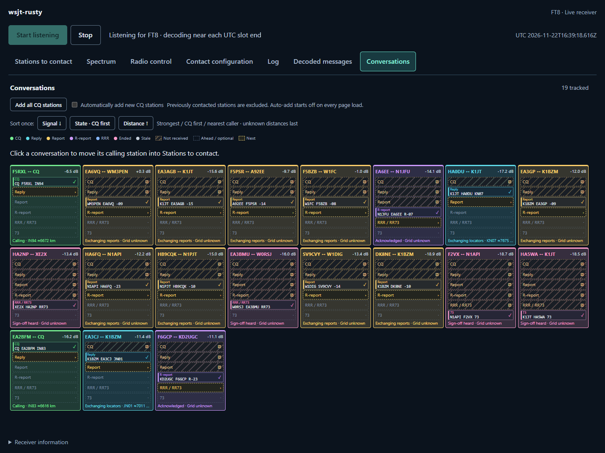
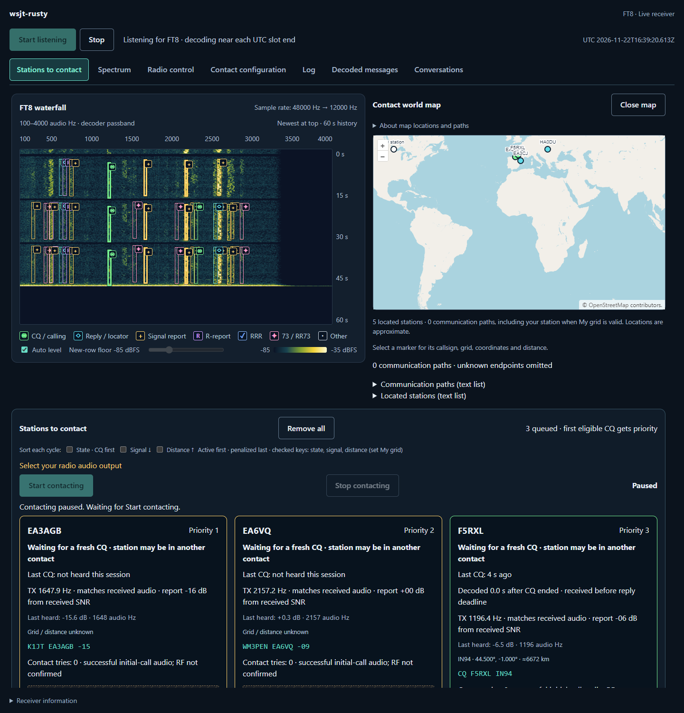

# wsjt-rusty

**A browser FT8 station for listening, following conversations, and contacting
stations from a live queue.** Watch decoded signals on the waterfall, see contacts
on a world map, run CQ-triggered exchanges, and keep a local log with ADIF export.

**[Open the browser app](https://aughey.github.io/wsjt-rusty/)** ·
[Browser guide](docs/browser.md) · [Radio setup](docs/rig.md) ·
[Contact log details](docs/contact-log.md)

Built on a Rust source port of WSJT-X, with local browser FT8 decoding and
FT8/WSPR-2 command-line and library support. See the [port details](docs/port.md)
for implementation coverage and limits.

## Listen and explore

Route your radio's receive audio to your browser/OS input, open the app, and click
**Start listening**. Grant microphone access when prompted. Use HTTPS or localhost
and keep your computer clock synchronized. Decoding happens on your device;
audio is not uploaded.

- **Stations to contact** puts the waterfall, world map, and queued station cards
  together in a responsive workspace.
- **Map** fills the workspace with decoded station locations and exchange paths.
- **Spectrum** shows the 100–4000 audio Hz waterfall, automatic or manual display
  leveling, and an optional input waveform. Decoded signals have colored outlines;
  hover or keyboard-focus them for the message, SNR, frequency, and UTC times.
- **Conversations** groups heard exchanges into compact cards with six stages,
  from CQ through reports to sign-off. Received messages, unheard stages, and
  inferred participants remain distinguishable. Sort by signal, state, or distance.
- **Decoded messages** lists up to 500 recent decodes with UTC start/end times,
  SNR, audio frequency, and the original payload on hover.
- The **world map** shows decoded grid locations, approximate distances from your
  grid, and exchange paths. Unknown locations stay unknown; inferred paths are
  dashed. Map tiles come from OpenStreetMap while the map is open.



*Conversations decoded from the included WSJT-X FT8 recording through simulated
microphone input. Missing stages are shown explicitly; cards estimate exchange
progress rather than confirm a QSO.*

Separate slot-response and background-recovery workers keep recovery work from
holding up the next slot attempt. The UI shows each lane's activity, duration, and
recovery lag. **Stop** releases the input and flushes final decodes; the waterfall
and received evidence remain available to inspect. A new listening session clears
receive observations. Browser decoding currently supports FT8; WSPR-2 is CLI/library
only. Device speed and browser scheduling affect real-time performance.

## Choose stations and make contacts

Click a **Conversations** card, or focus it and press Enter/Space, to put its caller
at the front of the waiting queue. **Add all CQ stations** and the optional
**Automatically add new CQ stations** help build a calling list; they exclude
previously completed contacts, your own station, and stale or busy conversations.
On **Conversations**, save an exclusion interval based on the persistent local log:
**Always**, a number of days (for example, 7 to recontact after a week), or **Off**.
Manual card selection overrides this exclusion.
Adding a station does not start transmitting.



*The same recorded input in Stations to contact. Contacting is paused; no radio
or transmit audio was used for these screenshots.*

1. In **Contact configuration**, enter your standard base callsign and grid,
   choose **Transmit audio output**.
2. In **Radio control**, explicitly connect and configure your IC-718 if using
   radio PTT. CI-V controls dial frequency, mode, and raw RF power; RTS/DTR keying
   supports shared or separate ports. CAT PTT is available for supported newer
   IC-718 revisions. See [radio setup and limits](docs/rig.md).
3. Return to **Stations to contact**, set the saved 0–60 dB **TX audio attenuation**,
   and click **Start contacting**. This prepares
   the selected audio output and arms CQ-triggered calls, one exchange at a time.
   A fresh CQ starts a call in the immediately following UTC slot. Addressed
   replies advance the exchange automatically through reports and sign-off.
4. Use **Stop contacting** to pause. Switching application pages keeps contacting and receiving active. Hiding the
   browser tab, stopping input, or an interruption disarms contacting and releases
   PTT; resuming then requires another explicit Start contacting.

Queued cards show received exchange stages, CQ age, decode delay/deadline, contact
tries, and local transmit status. Amber indicates playing audio; completed audio
retains a cyan **Sent audio** mark and its exact message. Sent audio and received
messages remain separate: local playback does not prove RF delivery or mutual QSO
completion.

Saved queue priorities combine **CQ first**, **strongest signal**, and **nearest
distance** each 15-second cycle. Until a partner report is received, contact is an
attempt: a fresh CQ selected by queue priority can replace it. Received partner
reports establish a QSO, which stays first until it ends. Move waiting
stations to the front or back, remove one, or **Remove all** to clear and disarm
the queue. Moving the active station to the back or removing it cancels its attempt.
Waiting stations expire after a saved CQ timeout (180 seconds by default). Initial
calls allow four unanswered transmissions; later stages allow three. Attempts
are bounded to eight transmissions or three minutes. Unanswered initial calls move
behind unpenalized stations for three minutes and await a fresh CQ.

The optional **find an open frequency** setting in Contact configuration uses up
to 60 seconds of received waterfall spectra to choose a low-occupancy transmit
space within 100–3000 audio Hz. It holds that frequency through an attempt's retries
and replies, and shows the footprint as a dashed cyan waterfall band. It waits for
recent spectrum data and estimates occupancy; it cannot guarantee a clear channel.
With this off, transmit follows the partner's latest decoded audio frequency.
Received SNR sets the outgoing report automatically. Queued frequencies get decode
priority while full-band decoding continues.

Audio output selection requires `AudioContext.setSinkId`; radio control requires
Web Serial. Use a browser exposing those APIs, such as desktop Chrome or Edge.
An unavailable saved output produces an error instead of falling back to another
device. Callsign, grid, output, attenuation, queue sorting, and radio settings are
saved per browser/site; restoring settings never connects or arms transmit.

## Keep a local contact log

**Log** offers Contacts and Evidence views with UTC times, callsigns, grids,
reports, outcomes, received decodes, and successful local TX audio. Records begin
when an armed queue schedules an attempt. Completed software exchanges leave the
queue and are marked **Contacted** on the conversation board.

The log is stored locally with SQLite in a worker and IndexedDB persistence. It
survives reloads and listening restarts, with visible saving errors and retry
controls. **Download ADIF** exports completed software exchanges; **Include
incomplete attempts** adds interrupted or in-progress attempts. Fresh connected
radio readbacks can supply RF dial frequency; audio frequency is never treated as
RF. Software completion does not assert QSL or mutual QSO confirmation.

Download backups: clearing site data or closing with unsaved records can lose
local data. There is no log synchronization, callsign lookup, or spot upload.
See the [browser guide](docs/browser.md) for operating details and the
[contact-log notes](docs/contact-log.md) for persistence and export semantics.

Conversation interpretation is also available as the independent, zero-dependency
[`ft8-conversations` crate](crates/conversations/README.md).

## Run the browser app locally

```sh
rustup target add wasm32-unknown-unknown
cargo install trunk --locked
cd crates/web
trunk serve --release --open
```

The local server rebuilds edits without reloading an active listening session.
Stop listening/contacting, then refresh the browser to load the updated app.

Open `http://localhost:8080`. Use release WASM for live operation. Static hosting
uses `trunk build --release`; serve the complete `crates/web/dist` directory,
including workers, worklet, JavaScript, and WASM. The
[Pages workflow](.github/workflows/pages.yml) deploys the browser app on pushes to
`main`. See the [browser guide](docs/browser.md) for transport, timing, deployment,
and browser validation details.

## Command line

```sh
# FT8 remains the default; the workspace has one binary, so this still works.
cargo run --release -- digirig-2026-11-21-2min.wav

# WSPR, using the public WSJT-X sample included as a test fixture.
cargo run --release -- --mode wspr tests/fixtures/wspr-150426-0918.wav

# Run both decoders against the same audio; JSON lines for downstream consumers.
cargo run --release -- --mode all --json recording.wav

# Narrow or move a single protocol's audio-frequency search range.
cargo run --release -- --mode wspr --min-hz 1390 --max-hz 1610 recording.wav
```

| Option | Behavior |
| --- | --- |
| `--mode ft8\|wspr\|all` | Default: `ft8`. `all` feeds the same audio to both decoders. |
| `--json` | One JSON object per decoded transmission; diagnostics go to stderr. |
| `--passes N` | 1–4 decode/subtraction passes; defaults: FT8 2, WSPR 3. |
| `--min-hz F --max-hz F` | Custom search bounds for a single selected mode. |
| `--stdin` | Read raw PCM16LE, mono, **12000 Hz**, until EOF instead of a WAV path. |
| `--realtime` | With `--stdin` and FT8, buffer audio and decode the latest 16 seconds at each UTC slot + 13.5 s. |

FT8 defaults to 100–4000 audio Hz. WSPR defaults to 1390–1610 Hz, matching
WSJT-X's normal 1500 Hz center and ±110 Hz search. WSPR searches one subband up
to 300 Hz wide; select another subband by changing both limits. It is WSPR-2,
not the historical WSPR-15 mode. A WSPR-2 frame has 162 symbols and lasts
**110.592 seconds**, normally transmitted in a two-minute period.

WAV input supports integer PCM and float samples, channel averaging, and
sample rates of at least 12 kHz. The shared low-pass resampler converts to
12 kHz. A single-mode file needs at least 13 seconds for FT8 or 108 seconds for
an attempted partial WSPR frame. Severe clipping can prevent a decode.

To feed an existing PCM producer:

```sh
pcm_producer | target/release/wsjt-rusty --mode all --stdin --json

# Live 12 kHz FT8. Decodes the latest 16 seconds at each UTC slot + 13.5 s.
pcm_producer | target/release/wsjt-rusty --stdin --realtime
```

The producer must provide headerless signed 16-bit little-endian mono samples
at exactly 12 kHz. For a WAV file use the file-path form; do not pipe its header
to the raw PCM input. Decoding is synchronous: the consumer provides
backpressure, and an upstream live-capture system must buffer audio accordingly.
The decoder flushes a final partial window at EOF. The CLI does not capture
sound-card audio directly; no network server is implemented.

`--realtime` is FT8 stdin only. It keeps the audio in the stream buffer and,
when the system clock reaches each UTC slot plus 13.5 seconds, decodes the
latest 16 seconds. Printed start times stay relative to the first sample. The
attempt is checked when the next PCM chunk arrives, and the decode blocks
further reads, so the producer has to buffer live audio across that work. This
mode does not run the automatic 30-second recovery windows.

## Rust port and libraries

See the [port and decoder development guide](docs/port.md) for workspace structure,
the headless Rust API, validation baselines, upstream provenance, and algorithm
limits.

## License

GPL-3.0-or-later, matching WSJT-X. Derived from work by Joe Taylor, K1JT,
Steven Franke, K9AN, and the WSJT development team. The Fano decoder derives
from Phil Karn, KA9Q (1994), with Taylor's modifications. The hash implementation
derives from Bob Jenkins' public-domain lookup3 algorithm through WSJT-X.
See `LICENSE`; dependencies retain their own licenses.
