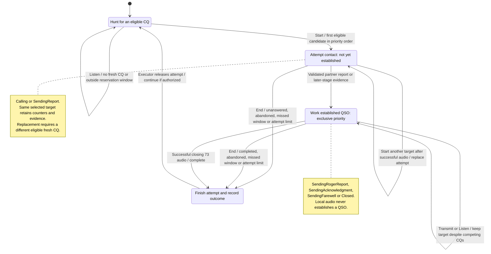
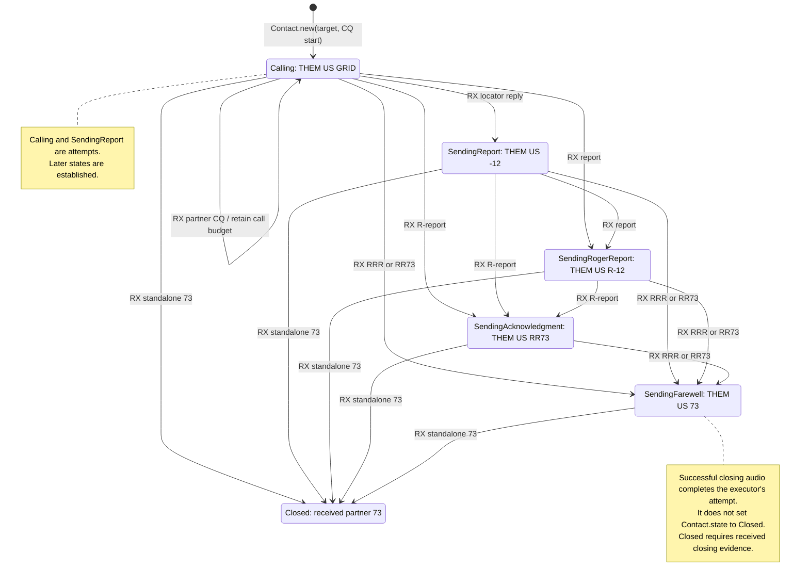
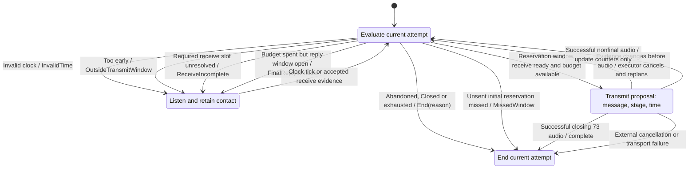

# FT8 contact policy state machines

These diagrams describe the current policies in the
[`ft8-conversations` crate](../crates/conversations/README.md). The top level hunts
for a QSO; the inner machine determines what to send to the selected station.
Timing, counters and received evidence make this an extended state machine:
state alone is insufficient to authorize a transmission.

The source of truth is [`manager.rs`](../crates/conversations/src/manager.rs)
for selection and scheduling, [`session.rs`](../crates/conversations/src/session.rs)
for `Contact`/`QsoState`, and
[`decision.rs`](../crates/conversations/src/decision.rs) for received-stage decisions.
The lifecycle names below are descriptive; the outgoing states use the actual
`QsoState` names. These diagrams document existing behavior, not a proposed rewrite.

## Hunt for a QSO

An executor must already be authorized to contact stations. `Start`, `Transmit`,
`Listen` and `End` below are policy results; devices and queue mutations remain
the executor's responsibility.

The selection guard requires all of the following:

- The supplied candidate order defines priority. Skip completed candidates and
  our own callsign; the crate does not sort the queue.
- The conversation is `Stage::Calling`, with no partner and a retained CQ.
- The latest CQ belongs to the immediately preceding 15-second slot. Its frame
  end is at or before the intended TX boundary and no more than five seconds old,
  inclusive. Frame starts are rounded to the nearest slot boundary.
- Its CQ start is newer than the executor's `attempted_cq_ms` watermark.
- The current time lies in the reservation window described below.

Decode arrival never refreshes a CQ. The selector itself does not consume one.
After at least one successful transmission, an unestablished attempt allows fresh
CQs to compete again. A different winner replaces it; selecting the same target
preserves the attempt. A locator reply advances the outgoing message to a report,
but still permits replacement. `is_established()` becomes true for a received
report **or any later stage**, so late entry need not include a separately heard
report. A received closing 73 can end the attempt immediately.

## Outgoing message within the selected contact

`RX` means accepted partner evidence addressed to us, except for the partner CQ
self-loop. Outgoing examples use
`THEM` for the target, `US` for our callsign, `GRID` for our locator and `-12` for
the executor's latest measured report. Each nonterminal state owes the displayed
message; entering it does not itself transmit.

Progress is monotonic: earlier-stage retries and delayed evidence cannot move the
state backward. Unshown nonadvancing events leave the state unchanged, except for
the abandonment rules below. Successful local audio leaves this RX-driven state
unchanged and updates only sent history/counters. Silence repeats the currently
owed message when scheduling allows; it does not advance the exchange.

`Contact::hear` accepts finite frame starts no earlier than the opening CQ and
only in the partner's slot parity. Directed evidence must be from the target to
our callsign, have three words, and belong to a slot strictly after the opening
slot. Classification requires a valid 77-bit ordinary payload (`i3` 1, 2 or 4);
unresolved callsigns do not form tracked contacts. Self echoes, unrelated traffic,
malformed payloads and wrong-turn frames cannot advance the contact. Valid delayed
evidence can skip missing stages without inventing received messages.

Before `SendingFarewell`/`Closed`, newer ordinary partner traffic can abandon the
attempt. It must have a frame start newer than `latest_ms` **and** be in a strictly
newer partner RX slot:

- A message from the partner to another recipient sets `PartnerAnsweredAnother`.
- Partner CQ after leaving `Calling` sets `PartnerResumedCq`.
- Partner CQ while `Calling` retains the state and original attempt budget.

After accepted RRR/RR73, CQ or other-recipient traffic cannot cancel the owed
closing 73. Attempt limits and external cancellation still apply.

## Slot and retry guards

This machine is evaluated repeatedly around each intended transmission. `Listen`
retains the contact; it does not return to hunting. End checks precede replacement
and scheduling. The executor rechecks a proposed transmission before keying and
after PTT acknowledgment.

Scheduling and limits are precise guards, not additional received stages:

- Slots last 15 seconds. Audio starts 500 ms after our nominal TX boundary;
  reservation is allowed from 1,800 ms to 200 ms before that audio time, inclusive.
  Idle selection rounds the current time to the nearest boundary. Active TX is
  opposite the retained partner receive slot, at least 30 seconds after the last
  successful audio start. After a successful transmission, a missed opportunity
  rolls forward by 30-second turns; an unsent initial attempt can end
  `MissedWindow` instead.
- With `require_receive_progress` enabled, an unestablished retry waits for the
  completed receive-slot watermark. A partner CQ in the immediately preceding
  receive slot permits a `Calling` retry early; a current addressed partner message
  permits a non-Calling response early, including repeated evidence. Neither old
  evidence nor recovery-worker completion substitutes for that receive slot.
  First transmissions, established QSOs and `SendingFarewell` do not wait for
  full-search completion. Established QSOs repeat the owed response on silence.
- Four successful transmissions while still `Calling` produce `Unanswered`.
  Later stages permit three transmissions of the current outgoing stage; the
  whole attempt permits eight transmissions. Renewed CQ never resets the call
  budget. Failed/canceled audio must not call `after_transmission`.
- Count limits retain the final reply window until
  `last_tx_ms + 30,000 - 1,800` ms. `Unanswered` takes precedence for a still-Calling
  attempt; other count exhaustion gives `AttemptLimit`. On successful audio,
  `after_transmission` counts consecutive transmissions of the same outgoing
  stage; if received evidence has already advanced beyond that transmitted stage,
  it returns a stage count of zero. Total sent count is retained.
- Elapsed attempt time strictly greater than 180,000 ms gives `AttemptLimit`
  independently of the final reply window. Abandonment and received `Closed`
  take precedence over budget checks.
- `after_transmission(..., SendingFarewell.step(), ...)` reports `complete = true`.
  Successful RR73 audio alone does not complete: the contact continues awaiting
  closing evidence or repeats RR73 within its limits.

## Received evidence and executor boundary

`Conversation::decision()` is a separate pure interpretation layer: CQ recommends
callback, callback recommends report, report recommends R-report, R-report
recommends acknowledgment, and RRR/RR73 recommends farewell. Standalone 73 returns
`Complete`. The next sender is the other observed participant; after a lone CQ
the responder is unknown. RR73 makes farewell optional in this generic decision,
while the contact policy still schedules closing 73. Missing earlier stages stay
unchecked, including on late entry; retained summaries preserve this distinction.

The generic tracker can become stale after four silent slots and expire after
three more; sign-offs retain three slots. This aging does not authorize TX or
replace the attempt budget, and stale evidence keeps its logical recommendation.

The browser executor owns operator Start/Stop, queue sorting/requeueing, attempted-CQ
watermarks, device readiness, audio/PTT reservation and release, persistence and
frequency/report measurements. The crate exposes a 180-second unanswered sorting
penalty constant, but applying it and retaining replaced stations are executor
work. Stop, hidden-tab/interruption handling and transport errors are external
cancellations, not partner-evidence transitions. Changed unstarted proposals must
be canceled and revalidated; started audio finishes without fabricating RX evidence.
Software completion and successful audio do not prove RF delivery or mutual QSO
confirmation. See [browser behavior](browser.md) for the executor contracts.
